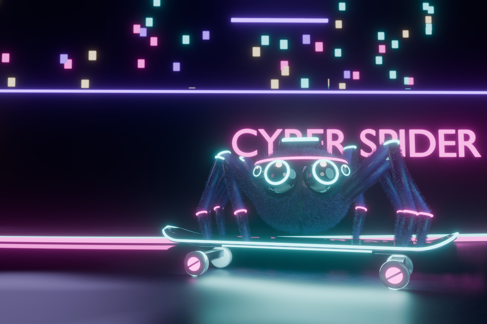

# Cyber Spider

A neon cyberpunk Omarchy theme: deep purple-black with cyan and magenta glow.
When you switch to it, a fuzzy cyber jumping spider skates up a kicker,
boardslides a glowing rail in a shower of sparks, kickflips off the end,
powerslides to a stop, and blinks at you. That last frame is the wallpaper,
with open space on the left for desktop icons.



## Install

```bash
omarchy theme install https://github.com/ryantzor/omarchy-cyber-spider-theme
```

Or paste the URL into *Install > Theme* in the Omarchy menu.

## Layout

- `colors.toml` - palette; Omarchy generates every app config from it
- `backgrounds/1-cyber-spider.jpg` - 4K still wallpaper (last frame of the intro)
- `backgrounds/intros/1-cyber-spider.mp4` - 6 s intro (144 frames @ 24 fps)
- `src/` - procedural Blender (EEVEE) scene that produces both
  - `scene.py` entry point: build, bake 144 frames, render
  - `anim.py` the frame-by-frame timeline
  - `spider.py`, `board.py`, `set.py` the character, skateboard and street
  - `reference.png` the concept art

## Re-render

Needs Blender 4.2+ (tested on 5.2) and ffmpeg.

```bash
cd src
blender -b -P scene.py -- video ../backgrounds/intros/1-cyber-spider.mp4
blender -b -P scene.py -- still /tmp/still.png --scale 2
magick /tmp/still.png -quality 92 ../backgrounds/1-cyber-spider.jpg
blender -b -P scene.py -- frame 58 /tmp/frame.png --scale 0.5 --samples 16
```
